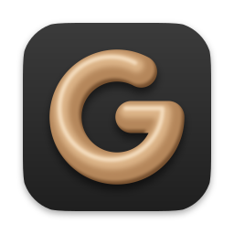

#  GigaSculpt

*mog the other sculpting programs*

GigaSculpt is a free, open-source digital sculpting app for pen and mouse. It is written in Rust,
draws with wgpu, and is licensed under the GNU GPL, version 3 or later.

GigaSculpt is early. It opens, sculpts, saves and loads, and everything below works today, but
expect rough edges and changes to the scene file format between versions. Linux comes first: it
is built and tested on every change. The Windows and macOS builds come from the same code; they
are new and less tested.

## What you can do

- **Sculpt** with 24 brushes in six families: Build, Carve, Move, Smooth, Mask and Paint, with
  pen pressure, alphas and stroke smoothing.
- **Add detail where you need it.** Live Detail adds triangles under the brush as you sculpt;
  subdivision levels let you work big forms low and fine detail high; Voxel Remesh, Quad Remesh,
  Decimate and Project Detail rebuild a mesh.
- **Work in parts.** Add, split, merge and pose parts with the Gizmo, mask and hide what you are
  not working on, sculpt with mirror, parallel or radial symmetry, and reshape a whole part with
  Deform.
- **Change the look.** MatCaps and materials, five lighting environments, and color painting.
- **Keep your work.** Scenes save as `.gss` files, with autosave and crash recovery. OBJ, PLY
  and STL files import and export, and a Blender add-on moves parts to Blender and back.
- **Script it.** Every action is a named command. The `gs` command-line tool drives a running
  session, replays scripts and renders pictures, and `gs mcp` serves the same commands to AI
  agents.

## Install

Download the file for your system from the [Releases](../../releases) page:

| System | File | Then |
|---|---|---|
| Linux (x86_64) | `gigasculpt-VERSION-linux-x86_64.tar.gz` | Unpack it and run `./gigasculpt` in the folder. |
| Windows (x86_64) | `gigasculpt-VERSION-windows-x86_64.zip` | Unpack it and run `gigasculpt.exe`. |
| macOS (Apple silicon and Intel) | `gigasculpt-VERSION-macos.dmg` | Open it and drag GigaSculpt to Applications. |
| Blender add-on | `gigasculpt-blender-addon-VERSION.zip` | In Blender 5.2 or later: Edit > Preferences > Add-ons, then Install from Disk in the menu at the top right. |

Keep `gigasculpt` and `gs` in the same folder: `gs` finds the app beside itself. GigaSculpt needs
a graphics driver with Vulkan on Linux (Mesa or your card maker's), DirectX 12 or Vulkan on
Windows, and Metal on macOS. The Linux build needs glibc 2.39 or newer.

The builds are not signed yet, so Windows and macOS warn the first time you open GigaSculpt;
[Troubleshooting](docs/troubleshooting.md#first-start-on-windows-and-macos) says what to do. To
build it yourself, see [Building from source](docs/building.md).

## First steps

1. Run `gigasculpt`. The window opens on the Workbench with an empty scene.
2. Choose Add > Sphere.
3. In the Detail section on the right, turn on Live Detail, so the sphere has room for detail.
4. Pick a brush on the shelf at the top and drag across the sphere with the pen or the left
   mouse button. Hold Shift to smooth, Ctrl to paint a mask, and Alt to work the other way.
5. Drag on the empty canvas, or with the right mouse button, to turn the view. A middle drag
   pans, and the wheel zooms.
6. Choose File > Save (Ctrl+S) to save the scene.

[Getting started](docs/getting-started.md) walks through a first sculpt in more detail, and
[Keys](docs/keys.md) lists every key.

## Documentation

[The GigaSculpt guide](docs/README.md) covers the whole app, page by page: the interface, every
brush and brush setting, masking, symmetry, detail, parts, looks and paint, files, settings, the
Blender add-on, scripting and troubleshooting.

## License

GigaSculpt is free software under the GNU General Public License, version 3 or (at your option)
any later version. See [LICENSE](LICENSE). Quad Remesh's helper program is built from other
open-source projects under their own licenses, which its build keeps beside it.

## Contributing

Bug reports, ideas and pull requests are welcome. [CONTRIBUTING.md](CONTRIBUTING.md) says how to
build, test and send a change, and [Troubleshooting](docs/troubleshooting.md#reporting-a-bug)
says how to report a bug.
