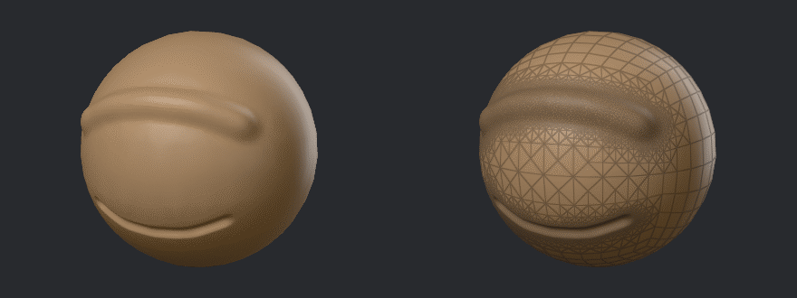
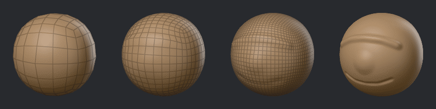

# Detail and remeshing

A brush can only move the points a part has, so fine detail needs many small faces. GigaSculpt
gives you four ways to get them, and three ways to rebuild a mesh that has gone uneven:

| Tool | Where | Use it to |
|---|---|---|
| Live Detail | Scene tray > Detail | Add triangles only where you sculpt, as you sculpt. |
| Detail levels | Scene tray > Detail | Divide the whole part, and step between coarse and fine versions of it. |
| Voxel Remesh | Mesh menu | Rebuild the part as an even mesh, joining overlaps and closing holes. |
| Quad Remesh | Mesh menu | Rebuild the part as clean quads in flowing rows (Linux only for now). |
| Decimate | Mesh menu | Lower the face count while keeping the shape. |
| Project Detail | Mesh menu | Copy the surface detail of one part onto another. |

After a menu runs one of these, the adjust panel opens in the corner of the 3D view with its
settings. Change one and the step runs again with the new value; F9 or Adjust in History opens
it again while that step is the newest.

The wire shows the faces: the Wire button in the header draws them, and its Density option
colors every part by the size of its faces on screen. See [Looks](looks.md#the-wire).

## Live Detail

With Live Detail on, the mesh adds triangles under the brush as you sculpt, and with Merge short
edges on it also joins edges that are too short, so the mesh does not grow without end. Only the
areas you work on get dense, so you can start from a plain sphere and sculpt fine detail where
you need it.

In the Detail section of the scene tray:

- **Live**: On turns it on or off.
- **Brush**, **Screen** and **Units** choose what the detail size is measured against: a share of
  the brush's size, pixels on screen, or scene units. Brush and Screen give finer triangles as
  you zoom in or use a smaller brush; Units gives the same size everywhere.
- **Size** is how small the new triangles are, in that measure.
- **Merge**: On joins short edges as you sculpt, and **Length** sets how short.

Pull Out grows new triangles as it pulls when Live Detail is on, and the Smooth brushes thin the
mesh a little as they even it out.

Live Detail cannot work on every part. When it cannot, its switch dims and its tip says why:

- a part with detail levels, which keep their faces as they are (keep one level, or unfreeze
  frozen levels);
- a part imported with UVs, which new triangles would tear;
- a brush that never adds triangles: the Move brushes, Clip Curve and Select Rect, the mask and
  paint brushes, and a brush with Wrap Mode above 1.

## Detail levels

Detail levels keep several versions of a part, each with four faces for every face of the one
below (three for a triangle). Sculpt big forms on a low level and fine detail on a high one;
changes on a low level carry up to the levels above. Levels are numbered from 1, the lowest.

In the Detail section of the scene tray:

- **‹** and **›** (Lower level and Higher level) step down and up.
- **Subdivide** adds a level on top, smoothed, and goes to it.
- **`···`** (Level operations) holds:
  - **Go to level…**: jump to a level by number;
  - **Delete lower** and **Delete higher**: keep this level as the lowest or the highest;
  - **Freeze** and **Unfreeze**: set the levels aside so the base can be remeshed, then rebuild
    them over the new base (see below);
  - **Reconstruct lower**: work out a level under the lowest one from its shape. It needs a base
    of quads that is one division of a coarser mesh.

Add > Sphere, Cube and Cylinder can start with levels: the adjust panel that opens with a new
part sets how many.

Some tools refuse a part with levels, because they change its faces: Voxel Remesh, Decimate,
Live Detail, Part > Mirror copy, the Split and Merge down items, and Mesh > Mirror and weld.
Freeze its levels first, or keep one level with Delete lower or Delete higher.

### Freezing levels

Freeze sets the levels aside and leaves the base. While frozen, you can voxel remesh or reshape
the base; most other tools refuse the part until you unfreeze it. Unfreeze then brings the
levels back:

- exactly as they were, when the base did not change;
- with your changes, when you only sculpted, masked or painted the base;
- projected onto the new base, when the base was remeshed: it is divided until it is about as
  dense as the old top level, and every point moves onto the old top's surface, taking its paint
  and mask with it.

## Voxel Remesh

Mesh > Voxel Remesh rebuilds the active part as an even mesh of quads. It closes holes and joins
overlapping pieces into one surface, so it is the tool to use after you have pulled the mesh
out of shape or merged parts that cross. The mask and the paint come across to the new mesh;
UVs do not, and face groups only with Keep groups.

Its adjust panel sets:

- **Resolution**: how many cells fit along the part's longest side, 16 to 2048. Higher keeps more
  detail and makes more faces. Or **Voxel size**: the size of one cell instead. The part keeps
  the size you used, so the next remesh uses it again, and a part sculpted bigger gets more
  faces rather than bigger ones.
- **Project**: moves the new surface onto the old one, keeping detail finer than a cell, with
  **Blur** to soften it;
- **Keep groups**: each new face takes the face group of the old face nearest it;
- **Close holes**: whether holes are closed with large triangles or left open.

Settings > Geometry > Hole closing sets whether holes are closed when you do not choose; see
[Settings](settings.md#geometry).

**Voxel mode** in the Mesh menu remeshes the part once when you turn it on. While it is on, a
Ctrl drag on empty canvas, with the mask clear, remeshes the part again at the size it keeps:
a quick way to even the mesh out between strokes.

Part > Remesh visible voxel remeshes every part that shows together into one new part.

## Quad Remesh

Mesh > Quad Remesh rebuilds the active part as quads in flowing rows, to a face count, for a
clean mesh to animate or to export. The form asks for:

- **Faces**: how many quads you want, 50 to 200,000 (5000 at first). The result lands near it.
- **Keep groups**: face group borders become lines the rows follow, and the groups come across.
- **Symmetry**: remesh one half and mirror it across an axis, so the result is exactly
  symmetric. The part must be symmetric already.
- **Detail**: keep the sculpted detail as levels above the quads.

Quad Remesh runs a separate helper program that is not part of the downloads yet and builds and
runs on Linux only for now. Without it, Quad Remesh says the program is missing and where it
looks. [Building from source](building.md#quad-remeshs-helper-program) says how to build it.

## Decimate

Mesh > Decimate lowers the part's face count while keeping its shape, as triangles. Give a
**Percent** of the faces to keep, or a number of **Faces**. The adjust panel then holds its
other choices: keep the face groups, the UVs and the paint, keep open edges in place, make the
triangles more even, and keep a symmetric part exactly symmetric. Masked areas keep their
density, so mask what must stay fine first.

## Mirror and weld

Mesh > Mirror and weld X, Y or Z copies the part's + side onto the other side across that axis
and joins the seam: use it to make a part symmetric again. To make a mirrored copy as a separate
part instead, use Part > Mirror copy X, Y or Z (see [Parts](parts.md#the-part-menu)).

## Project Detail

Mesh > Project Detail copies the surface detail of another part onto the active one. Keep the
old, detailed part, remesh a copy, then project the old part's detail onto the copy. The form
asks for:

- **Source**: the part the detail comes from;
- **Distance**: how far a point may move to find the source's surface (2% of the source's size
  at first);
- **Divide**: divide the active part toward the source's face count as it projects. It needs a
  part with one level.

A typical round trip: Part > Duplicate, Voxel Remesh or Quad Remesh the copy, then Project
Detail from the original, and hide or delete the original.
