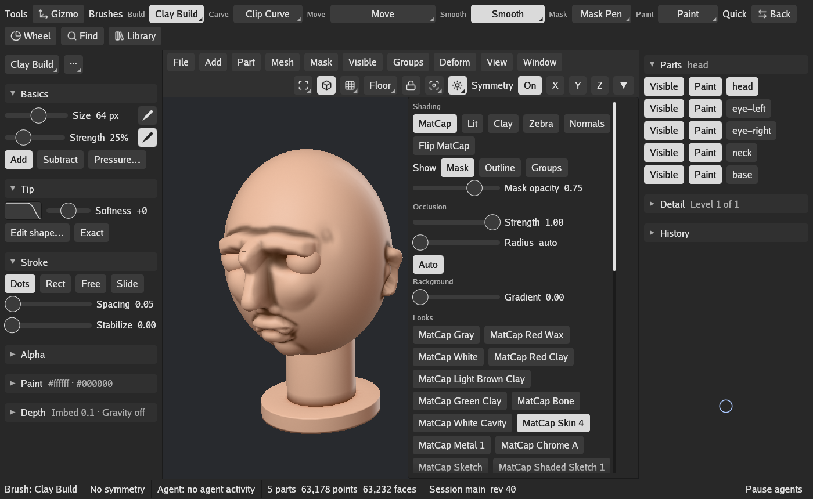

# Getting started

This page takes you from a sphere to a first sculpt, then saves it. [The interface](interface.md)
explains each part of the window and lists the keys.

## Open the app

Run `gigasculpt` (on Windows `gigasculpt.exe`, on macOS GigaSculpt in Applications). With no
arguments it opens the window on the Workbench with an empty scene. A few options, given after
`window`:

```
gigasculpt window --width 1600 --height 1000   # the window's size in points
gigasculpt window --driver x11                   # Linux: SDL's video driver, x11 or wayland
gigasculpt window --no-autosave                  # no autosave and no crash recovery
gigasculpt window --session studio               # a session name other than "main"
```

`gigasculpt window --help` lists them all, and `gigasculpt --version` prints the version.

## A first sculpt

1. **Add a sphere.** Choose Add > Sphere. The adjust panel opens with the sphere's settings
   (its form, density and detail levels); change them or carry on.
2. **Give it room for detail.** Press Backslash to turn on Live Detail, which adds triangles
   under the brush as you sculpt. Or press Ctrl+D to subdivide the part once or twice; D and
   Shift+D then step up and down its levels.
3. **Build up a form.** Pick Clay Build from the Build family on the shelf at the top (or type
   B, C, B). Drag across the sphere with the pen or the left mouse button. Hold Alt while you
   drag to dig in instead of building up.
4. **Move big shapes.** Pick Move from the Move family (B, M, V) and drag to pull the form
   around. Press S, U or O and drag to change the brush's size, strength or softness, or use
   the sliders in the brush tray on the left.
5. **Smooth.** Hold Shift while you drag to smooth with the Smooth brush, whatever brush is
   picked.
6. **Turn on symmetry.** Press X to mirror strokes across X, or use the Symmetry buttons at the
   right end of the header.
7. **Mask.** Hold Ctrl and drag to paint a mask; masked areas are held still by brushes and
   deformers. Ctrl+I inverts the mask and Alt+M clears it. With Ctrl held, a tap on the empty
   canvas inverts the mask and a drag there clears it.
8. **Change the look.** Press F6 for the materials, or open Look at the right of the header,
   and pick a MatCap.

   

Ctrl+Z undoes and Ctrl+Shift+Z redoes. The History section of the scene tray on the right names
the step each would take.

## Parts

A scene holds any number of parts. Add another with Add > Sphere, Cube or Cylinder; the Parts
list at the top of the scene tray shows them all. Click a part to make it the one you sculpt,
and click its Visible button to hide or show it (Paint beside it shows or hides its painted
color). The Part menu duplicates, mirrors, renames, splits, extracts, merges and deletes
parts.


## Saving and opening

- **Ctrl+S** saves the scene to its own `.gss` file, keeping the old one as a backup; the first
  time it asks for a name.
- **Ctrl+O** opens a scene or Part file. **Ctrl+N** starts a new scene.
- **Ctrl+Alt+S** saves under the next number (head_001, then head_002).
- **9** writes a quick numbered copy to the scene's autosave folder.
- **File > Save Part file** writes the active part alone (Ctrl+Shift+T).
- **File > Import a file** and **Export a file** read and write OBJ, PLY and STL.

The window autosaves: a copy goes to the autosave folder 10 minutes after the last save, once
you have paused for 2 minutes. If GigaSculpt stops unexpectedly, the next start offers the
work back.

## Where GigaSculpt keeps its files

On Linux GigaSculpt follows the XDG folders:

| What | Where |
|---|---|
| Your keys, saved layouts and settings | `$XDG_CONFIG_HOME/gigasculpt` (usually `~/.config/gigasculpt`) |
| Command logs and autosaves | `$XDG_STATE_HOME/gigasculpt` (usually `~/.local/state/gigasculpt`) |
| Session sockets, for `gs` and the Blender add-on | `$XDG_RUNTIME_DIR/gigasculpt` |

Every session writes a command log, one line per command. `gs run` replays it into a fresh
session to rebuild the scene; see [Scripts and agents](scripting.md).

## Blender

The Blender add-on moves parts between a running GigaSculpt and Blender 5.2 or later, keeping
the mask, face groups, hidden faces and paint that file formats drop.

1. Install `gigasculpt-blender-addon-VERSION.zip` from the release in Blender: Edit >
   Preferences > Add-ons, then Install from Disk in the menu at the top right. Its preferences
   hold the session name (`main` unless you started GigaSculpt with `--session`).
2. With GigaSculpt running, open Blender's 3D view sidebar (N), the GigaSculpt tab, and click
   Get from GigaSculpt. Every part loads as a mesh object; a second click updates the objects
   it loaded before.
3. To bring work back, select mesh objects in Blender and click Send to GigaSculpt. They land
   in GigaSculpt as one undo step: an object that came from a part updates that part, and any
   other becomes a new part.

GigaSculpt's File menu has the same two moves from its side: Send to Blender writes every part
for the add-on, and Read from Blender reads what the add-on sent.
