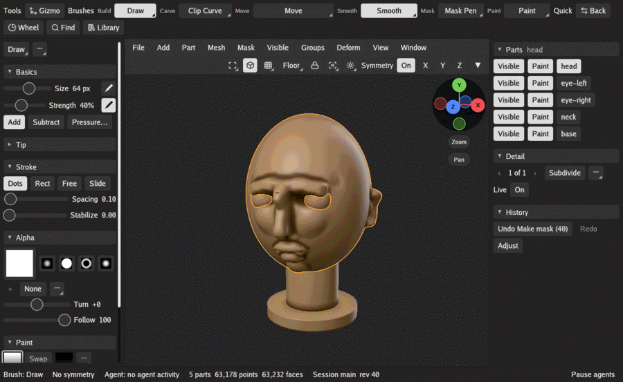
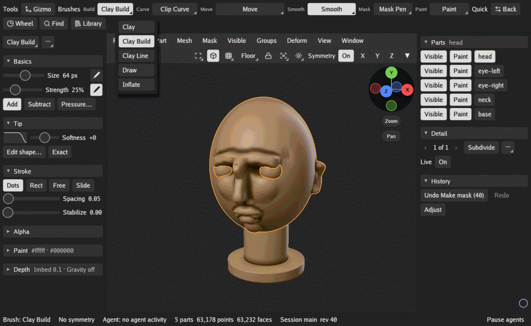
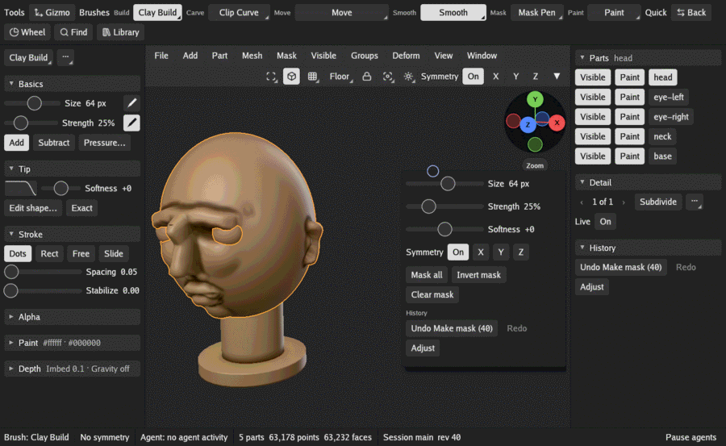

# The interface

GigaSculpt's window is the Workbench: the 3D view in the middle, with shelves and trays around
it grouped by task. Every button runs a named command, the same one `gs` and scripts run.

Rest the pointer on a control to see what it does; many of these tips end with the control's
key. Hold Ctrl over a control for a fuller box: what it does, the command it runs and its key.
Hold Ctrl+Alt for the command's whole description.

## The parts of the window

- **The brush shelf** runs along the top. It holds the Gizmo tool (see
  [Parts, the Gizmo and Deform](parts.md)), then a button per brush family: Build, Carve, Move,
  Smooth, Mask and Paint. What you pin in the Library follows as favorites, then Quick: Back
  (the brush you used before), Wheel (the brush wheel), Find (the command palette) and Library.
- **The header** runs along the top of the 3D view with the menus: File, Add, Part, Mesh, Mask,
  Visible, Groups, Deform, View and Window. Its other end holds the view's buttons (Frame,
  Perspective, Wire, Floor, Lock and Isolate), then Look (shading, MatCap, lighting and the
  material) and Symmetry. When the 3D view is too narrow, the menus fold into one Menus button.
  Inside a menu, items sit under small headings and some show a shorter name (under Split, Split
  by groups shows as Groups). This guide uses the full names, which the command palette finds.
- **The brush tray** (on the left for a right-handed pen) holds what the next stroke does: the
  brush's name and its `···` menu, then Basics, Tip, Stroke, Alpha, Paint and Depth. See
  [Brush settings](brush-settings.md).
- **The scene tray** (on the right) holds the Parts list, Detail (subdivision levels and Live
  Detail) and History (Undo and Redo, each naming its step, and Adjust).
- **The status line** along the bottom shows the brush, the symmetry, any agent at work, and how
  many parts, points and faces the scene has. It shows a bar with Cancel while a long command
  runs.

### Brush families

A tap on a family's button picks the brush it shows. A held press, a right click, or a tap while
it is already lit opens the whole family so you can pick another; the button then shows that
one. Smooth works a little differently: the brush it shows is the one Shift smooths with, and a
tap opens the family to choose that brush. [Brushes](brushes.md) describes every brush. Rest the
pointer on a brush to see its key.

### Windows that open on top

| Opens with | What |
|---|---|
| Shift+Space | The quick menu at the pointer: the brush's Size, Strength and Softness, the symmetry switches, the mask's operations and the history. Right after it opens, the mouse wheel sizes the brush. |
| Find on the shelf, or Space | The command palette: type a few letters to find any command or setting by name and run it. |
| Adjust in History, or F9 | The adjust panel: change the settings of the command you just ran, such as a new sphere's density or a remesh's resolution. |
| Library on the shelf | The Library along the bottom of the 3D view: Brushes, Alphas, Materials, Environments, Layouts and Themes, as rows of tiles. A tap on a tile uses it, and its Pin puts it on the shelf as a favorite. |
| Wheel on the shelf | The brush wheel at the pointer. Move toward a brush and let go to pick it; type a letter to jump to a brush. A right click on a slot puts the brush you are using there. |
| Window > Settings | The settings window; see [Settings](settings.md). |

### Arranging the window

Window > Left hand and Right hand swap the trays' sides. Drag a tray's inner edge to make it
wider or narrower, and click a section's title to fold it. Window > Panels has Left tray, Right
tray and All panels, which hides and shows them. Window > Save arrangement 1, 2 or 3 keeps what
is on screen, and Window > Arrangement 1, 2 or 3 brings it back. Window > Next layout and
Previous layout switch between layouts, and Restore layout shows the Workbench as it ships.

## Moving the view

| Press and drag | Drag | With Alt | With Ctrl | Shift during |
|---|---|---|---|---|
| Right mouse button, or the pen's barrel button, anywhere | Orbit | Pan | Zoom | Land on the nearest side view |
| Left mouse or pen tip on empty canvas | Orbit | Pan | | Land on the nearest side view |
| Middle mouse button, or the pen's second barrel button | Pan | | | |

The mouse wheel zooms toward the surface under the pointer. The figure in the view's corner
orbits when dragged, and the Zoom and Pan buttons under it zoom and pan, for a pen with no
buttons. The View menu has Level, Look along X, Y and Z, Iso view, and Undo view move and Redo
view move (up to 50 steps back). [Settings](settings.md#navigation) changes how orbiting, the
pivot and zooming behave.

## Held keys while sculpting

| Hold | The stroke |
|---|---|
| Shift | Smooths, with the brush the Smooth family shows (Smooth at first) |
| Ctrl | Paints a mask, with Mask Pen |
| Shift+Ctrl | Selects what shows, with Select Rect |
| Alt | Works the other way: digs instead of building, unmasks instead of masking |

Ctrl alone on empty canvas works on the mask: a tap inverts it and a drag clears it. With no
mask to clear and Voxel mode on, the drag remeshes the part instead (see
[Detail and remeshing](detail.md#voxel-remesh)).

Settings > Interface can make these keys sticky, so a tap of Shift, Ctrl or Alt keeps it on
until the next tap; see [Settings](settings.md#interface).

## Sliders

Drag a slider to set it, or click its value to type one. Hold Shift while dragging to round the
value. Double-click a slider for a finer handle, and Ctrl+double-click to put it back to its
default. The mouse wheel over a slider steps it.

## Keys

[Keys](keys.md) lists every built-in key. Rest the pointer on a brush or a button to see its
key, and Settings > Keys lists every key in force, your own changes included.

## Changing keys

Hold Ctrl+Alt and click any button or switch, then press the key you want for it (Escape
cancels). If another command holds that key, GigaSculpt asks before replacing it. Sliders and
list rows cannot be bound this way. Settings > Keys has Bind a key… for any command. Your
changes are kept in `keymap.toml` in GigaSculpt's config folder (see
[Files](files.md#where-gigasculpt-keeps-its-files)), on top of the built-in keys.
