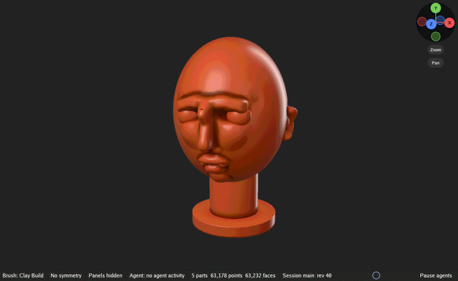

# Looks and paint

How the model is drawn changes nothing about its shape. This page covers the Look options, the
wire and the floor, Reference Views, and painting color onto the surface.

## The Look options

Look sits in the header, after the view's buttons. Click it to open its options, from top to
bottom: Shading, the looks, Tone, Environment, Lights and Material. Each setting is the
session's, so every view draws with it.

### Shading

The first row picks how the model is shaded:

| Mode | What it shows |
|---|---|
| MatCap | The selected look as a MatCap: a sphere picture with its light baked in, so the environment and lights change nothing. The fastest and steadiest way to judge form. |
| Lit | The selected look as a material, lit live by the environment and the lights. |
| Clay | Every part as light brown clay, lit live as Lit is. |
| Zebra | Reflection stripes over clay, so a small change in shape shows as a large bend in the stripes. Good for checking that a surface is smooth. |
| Normals | Each surface colored by the direction it faces. |

Then, each only while it applies:

- **Flip** (Flip MatCap, in MatCap mode) reads every MatCap mirrored, so its light comes from the
  other side.
- **Show**: **Mask** shows the mask's dark tint, **Outline** outlines the active part while two
  parts or more show, and **Groups** shows one flat color per face group in place of the paint.
  None of them changes what the mask holds back.
- **Mask opacity**: how dark a fully masked surface is drawn.
- **Occlusion**: **Strength** darkens creases and hollows, **Radius** sets how far a surface
  looks for what blocks its light, and **Auto** sets that radius from the model's size.
- **Subsurface** (in Lit mode): **Strength** and **Radius** of the light that scatters under the
  surface, for looks such as skin and wax.
- **Background**: **Gradient** lays a white gradient over the background color, **Center** sets
  how far down the view it sits, and **Softness** how soft it is. The background is saved with
  the scene.

### The looks

GigaSculpt ships 20 looks:

- **13 MatCaps**: Bone, Chrome A, Gray, Green Clay, Light Brown Clay, Metal 1, Red Clay, Red Wax,
  Shaded Sketch 1, Sketch, Skin 4, White and White Cavity (each titled "MatCap" first, such as
  MatCap Skin 4);
- **6 materials**: Basic Material, Basic Material 2, Fast Shader, Reflected Map, Soft Skin Shader
  and Toy Plastic;
- **Flat Color**, which shows the paint exactly as stored, with no light at all; unpainted parts
  show white.

Click a look in the Look options to use it, or open the Library's Materials row (Library on the
shelf). GigaSculpt starts in MatCap Gray.

### Tone

- **Exposure**: how bright the light is drawn, in stops; +1 doubles it. Every mode but Normals
  takes it.
- **PBR Neutral**, **AgX** and **Standard** choose how light turns into screen color: PBR Neutral
  keeps base colors as they are set, AgX handles bright light as film does, and Standard clips
  what is too bright.

### Environment and Lights

These show in Lit, Clay and Zebra modes, which they light.

- **Environment**: **Look's own** lights each look with its own environment (Studio for most), or
  pick one for every look: **Studio**, **Soft studio**, **Studio Small 08**, **Studio Small 09**
  or **Photo Studio 01**. Each stays fixed to the camera as you turn the view. The Library's
  Environments row lists them too.
- **Lights**: **Key light** turns the environment's main light on or off, and **Ambient** scales
  the rest of its light (1 as it ships).

### Material

The last section is the selected look's own material: its picture (which opens the Library's
Materials row), its title, and **Slot**, which steps through the looks in order. For every look
but Flat Color, it then shows the material's colors, the environments that can light it, and
sliders for Metalness, Specular, Roughness, IOR, Coat, Coat roughness, Coat IOR, Subsurface and
Scatter radius. The six materials add Cavity intensity, Cavity radius and Cavity colorize. A
change is one step of the material's own undo when you let go.

The `···` beside the material's title holds:

| Item | What it does |
|---|---|
| Undo, Redo | Steps through the material changes only; the sculpt never changes. |
| Reset | Puts a shipped look's settings back. Its name stays. |
| Copy | Makes a copy of the look that you can change, rename and delete, leaving the shipped one as it is. |
| Rename | Gives the look a new title, the name shown for it. |
| Delete | Deletes a look of your own. Shipped looks stay. |

Your changes, copies and the selected look are saved in the scene file. Look files of your own
(`.toml`) in the `materials` folder of GigaSculpt's config folder are read when GigaSculpt starts
and join the list; see [Files](files.md#where-gigasculpt-keeps-its-files).

## The wire

**Wire** among the header's view buttons draws the polygon edges over the parts. Held or
right-clicked, it opens how the wire is drawn:

- **Edges**: draw the edges; off, the wire shows only its group fill.
- **Fill** (Group fill): show the face group colors in place of each part's paint while the wire
  shows.
- **Density** (Polygon density): color every part by the size of its faces on screen, wire or
  not: red at 32 pixels across or more, green at 8, blue at 2 or less. Use it to see where Live
  Detail or a remesh has made the mesh fine enough for the detail you want.
- **Dots**: draw the wire only while the view moves, so you see the mesh as it turns without it
  covering the model at rest.
- **Opacity** (Edge opacity): how much an edge covers the surface.

## The floor

**Floor** shows a grid under the parts. Held or right-clicked, it opens:

- **Show floor**;
- **Planes**: **X**, **Y** (the floor itself) and **Z**, each in its axis color;
- **Snap**: keeps each plane just past the far side of the model as the view turns. With Snap off,
  **Height** sets where the planes sit, from -1 (below the model) to 1 (above it);
- **Size**: 0 for an endless grid with lines at powers of ten, or a square this many times the
  model's largest side, with **Tiles** cells along each side;
- **Fill**: **Opaque**, **Light** or **Strong** see-through, or **Facing**, which also makes the
  parts see-through where they face you;
- **Axis colors**: how strongly each plane's lines take its axis color.

## Reference Views

A Reference View shows a model beside the 3D view, for reference while you sculpt. The View menu
opens one:

- **Reference from a file** shows a model file. It never enters the scene.
- **Reference: this scene** shows this scene, live: for example the whole model while you work
  close.
- **Reference from parts** shows copies of the parts you name, as they are now; later edits do
  not show in it.

The reference docks between the 3D view and the scene tray; drag its inner edge to resize it.
Its bar has:

- **Follow**: **Turn**, **Zoom** and **Slide** make it turn, zoom and slide with the 3D view.
- **Align** shows the same side the 3D view shows from then on, sized and placed to match the
  sculpt. Turn it to match first, with Turn off.
- **Frame** fits the reference in its view, and **Wire** shows its edges.
- Its own **Look**, followed by the name of the look the reference draws with: the 3D view's
  until you pick another. Tap either to pick a MatCap for it, or **Same as the view**.
- **Next**, which makes the next open reference the one the bar acts on, and **Close**, which
  closes it. The sculpt does not change.

## Painting

Every part can hold color painted onto its points. Paint with the Paint family's brushes (see
[Brushes](brushes.md)), or let a sculpting brush paint as it sculpts.

The brush tray's **Paint** section holds:

- **Main** and **Secondary**, the two colors, with **Swap** between them. Tap a swatch to edit it
  (it gets a ring); tap it again, or hold either one, to open or close its color. An open color
  shows a color picker, a hex field (such as `#c08060`) and Red, Green and Blue sliders.
- **Drag from a swatch onto the model** and let go to pick the color painted there into that
  swatch. Hold Alt as you drag to pick the color as it shows on screen instead.
- **`···`** (Paint options): **Fill part** paints the active part Main, and **Fill visible**
  paints every part that shows, both at the brush's Color Strength.
- **Strength** (Color Strength): how far a whole stroke can change the color, and how much of Main
  a Fill mixes in.
- **Gradient**: a stroke paints Main at its center and Secondary at its rim.
- **Alternate**: holding Alt paints Secondary.
- **Brush > Color** (on a brush outside the Paint family): lit, the brush paints Main as it
  sculpts. The Move brushes and the gesture brushes (Clip Curve and Select Rect) cannot paint.

Changing a color is not an undo step; painting is.

To see the shape without its paint, turn off the part's **Paint** switch in the Parts list (see
[Parts](parts.md#the-parts-list)); the paint is kept. Flat Color shows the paint alone, with no
shading. Export to OBJ or PLY keeps the colors (see
[Files](files.md#importing-and-exporting)), and [the Blender add-on](blender.md) carries them to
Blender.
