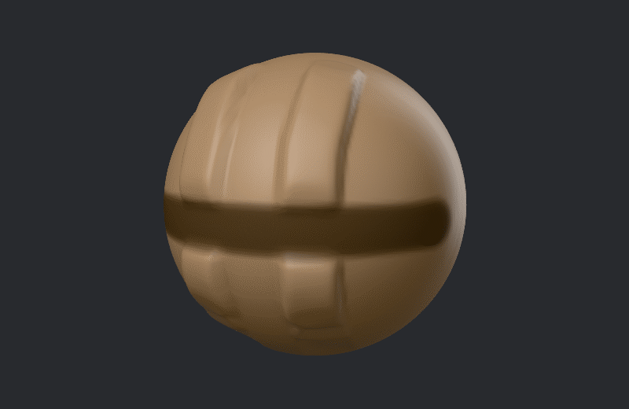
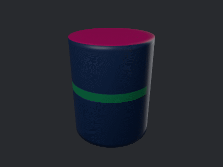

# Masking, visibility and face groups

Three tools split a part into areas:

- **The mask** holds areas still. It can be partial, so an area half masked moves half as much.
- **Visibility** hides faces that are in the way, so you can reach and see the rest.
- **Face groups** split the surface into named areas, each with its own color, that other tools
  can pick out.

Each part has its own mask, hidden faces and face groups, and scene files keep all three.

## The mask

Hold **Ctrl** and drag to paint a mask with Mask Pen, whatever brush is picked. Hold
**Ctrl+Alt** to paint it away. With Ctrl held, a press on the empty canvas around the model works
on the whole mask: a tap inverts it and a drag clears it.

Masked areas show as a dark tint. Look > Shading > Show mask (Mask) hides or shows the tint, and
Mask opacity sets how dark it is. A hidden tint still holds the surface back.

What the mask holds back:

- every brush that shapes the surface;
- Deform's sliders, and the Gizmo while its Mask holds back switch is on (see
  [Parts, the Gizmo and Deform](parts.md));
- Decimate, which keeps the density of masked areas.

What the mask picks out:

- Visible > Hide masked and Hide unmasked;
- Groups > Group masked faces;
- Part > Split by mask and Extract;
- the Frame button's Mask and Unmasked, which frame the view on them.

### The Mask menu

| Item | What it does |
|---|---|
| Mask all | Masks the whole part. |
| Invert mask | Masked becomes unmasked and the other way round. |
| Clear mask | Removes the mask. |
| Grow mask, Shrink mask | Moves the mask's edge out or in by one ring of points. |
| Blur mask, Sharpen mask | Softens the mask's edge, or makes it crisper. |
| Boost mask, Dilute mask | Makes the whole mask stronger or weaker. |
| Normalize mask | Stretches the mask so its weakest point is unmasked and its strongest fully masked. |
| Mask by cavity | Masks the creases and hollows. Good for holding fine detail still while you smooth or paint the rest. |
| Mask by features | Masks the open borders and the lines where face groups meet. |

## Hiding faces

Hidden faces are out of the way: brushes and deformers leave them alone, and you can see past
them to what is behind.

Hold **Shift+Ctrl** and drag a rectangle to use Select Rect, whatever brush is picked. Through
the whole model, the faces under the rectangle stay shown and the rest are hidden. Hold Alt as
well to hide the faces under it instead.

### The Visible menu

| Item | What it does |
|---|---|
| Hide masked, Hide unmasked | Hides the masked faces, or the unmasked ones. |
| Show unmasked | Shows the unmasked faces again. |
| Show all | Shows every face. |
| Grow visible area, Shrink visible area | Shows one more ring of faces around what is visible, or hides the outer ring. |
| Invert visibility | Hidden faces show and visible ones hide. |
| Show whole shells | Shows every face of any separate piece that is partly visible. |
| Show whole groups | Shows every face of any face group that is partly visible. |

Hiding faces is not the same as hiding a part. To hide a whole part, use its Visible button in
the Parts list, or Isolate to see one part alone; see [Parts](parts.md).

## Face groups

Face groups split a part's surface into areas. Look > Shading > Groups shows each group in its
own flat color, and so does the wire's Fill (see [Looks](looks.md#the-wire)).

### The Groups menu

| Item | What it does |
|---|---|
| Groups from shells | Gives each separate piece of the part its own group. |
| Groups by surface angle | Splits the part into groups wherever the surface turns more than 30 degrees: a cube gives six. |
| Group visible faces | Puts every visible face in one new group. |
| Group faces facing the camera | Puts the visible faces turned toward the view in one new group. |
| Group masked faces | Puts the masked faces in one new group, or every visible face when nothing is masked. |
| Group masked faces and clear mask | The same, then clears the mask, in one undo step. |
| Visible faces to a group | Puts every visible face in one group: a new one, or the number you give. |
| Merge groups | Folds the groups you name into one. |

What uses face groups:

- Visible > Show whole groups;
- Mask > Mask by features;
- Part > Split by groups, which makes a part of each group;
- Voxel Remesh and Quad Remesh, which can keep the groups (see [Detail](detail.md));
- Export to OBJ, which writes each group as an OBJ group (see [Files](files.md#importing-and-exporting)).

A good habit: before splitting a part or remeshing it, turn the areas you care about into
groups with Group masked faces and clear mask.
