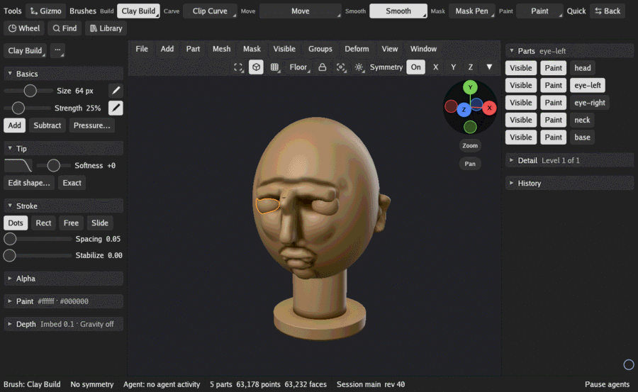

# Parts, the Gizmo and Deform

A scene holds any number of parts: a head, two eyes, a hat. You sculpt one part at a time, the
active one, and each part has its own mask, face groups, detail levels and paint.

## The Parts list

The Parts list sits at the top of the scene tray, and its title names the active part. Each row
is a part, and its buttons are lit while they are on:

- **Visible** hides or shows the part. Shift+click gives every part the state the click gives
  this one: on a part that shows, it hides every part but the active one; on a hidden part, it
  shows them all.
- **Paint** shows or hides the part's paint. The paint is kept while hidden. Shift+click sets
  every part the same way.
- **The name**: click it to make the part active. Strokes, the Part menu and the Mesh menu work
  on the active part.

Settings > Interface > Rows shown sets how many rows show before the list scrolls, 1 to 24. It
never limits how many parts a scene holds.

Add > Sphere, Cube and Cylinder add a new part at the end of the list and make it active. The
adjust panel then sets its form, density and detail levels.

## The Part menu

| Group | Item | What it does |
|---|---|---|
| | Duplicate | Copies the active part, with its levels, mask and groups, directly below it. |
| | Mirror copy X, Y, Z | Adds a copy of the active part mirrored across the scene's origin, directly below it. |
| Order | Rename | Gives the active part a new name. No two parts may share a name: a taken one keeps the form open, with your text, to pick another. |
| Order | Move up, Move down | Moves the active part one place in the list. |
| Order | Show all parts | Turns every part's Visible on. |
| Split | Split into shells | Cuts the part into one part per separate piece. |
| Split | Split by groups | Cuts the part into one part per face group. |
| Split | Split by mask | Cuts the masked faces off into a new part, paint and groups kept. |
| Split | Split off hidden | Cuts the hidden faces off into a new part. |
| Split | Extract | Adds a thick shell made from the masked faces (or every visible face when none is masked) as a new part: a quick start for clothing, armor or a helmet. |
| Merge | Merge down | Joins the active part and the one below it into one part. |
| Merge | Merge visible | Merges every part that shows into one new part; the parts stay as they are. |
| Merge | Remesh visible | Voxel remeshes every part that shows into one new part of even quads; the parts stay as they are. |
| Delete | Delete | Deletes the active part. One undo brings it back. The Delete key does the same. |
| Delete | Delete others | Deletes every part but the active one, in one undo step. |
| Delete | Delete hidden | Deletes every part whose Visible is off, never the active part, in one undo step. |
| Delete | Delete all | Deletes every part, leaving the scene empty, in one undo step. |

Mirror copy, the Split items and Merge down refuse a part with detail levels, so they are gray
on one; hover over an item to see why. See [Detail levels](detail.md#detail-levels). In an empty
scene the Delete items are gray. So are Delete others and Delete hidden while they would delete
nothing: Delete others with one part, Delete hidden with no part hidden.

## Showing one part

The Isolate button among the header's view buttons shows the active part alone, or every part again. Held or
right-clicked, it opens its options: a button for each part, which shows that part alone (press
the part shown alone to end Isolate), and:

- **Dynamic**: while the view turns, only the active part is drawn, so a heavy scene turns
  smoothly.
- **Click on canvas**: a click on empty canvas isolates the active part, or ends Isolate.
- **End Isolate**: shows every part again.

Look > Shading > Outline outlines the active part while two parts or more show, so you can see
which one your strokes go to.

## The Gizmo

The Gizmo moves, turns and scales a part, or bends it with a deformer. Click **Gizmo** at the
start of the brush shelf to turn the Gizmo tool on; while it is lit, the pen works the Gizmo
instead of sculpting. Click it again to sculpt again.

With the tool on:

- **A press on the model** puts the Gizmo there, standing on the surface. Drag before you let go
  to aim it toward the pen.
- **The arrows** move the part along an axis, **the plane squares** move it across a plane, and
  **the center** moves it across the screen.
- **The small boxes** on the axes stretch the part along one axis, and **the grip** scales it
  evenly.
- **The rings** turn the part about an axis, and **the outer ring** turns it about the line you
  look along.
- **A press on empty canvas** moves the view, as usual.

While you drag a handle:

| Hold | The drag |
|---|---|
| Ctrl | Moves, turns or scales a copy of the part, which becomes the active part. The boxes ignore Ctrl. |
| Alt | Moves the Gizmo alone, leaving the part where it is. |
| Shift | Snaps a turn to steps of 5, 15 or 45 degrees, as Snap says in the brush tray, and a move to steps of 0.01 scene units. Scaling does not snap. |

The brush tray shows the Gizmo's settings while the tool is on:

- **Softness** fades a drag out toward the edge of **Reach** (the brush's Size). At -100 the part
  moves rigidly, as one piece; higher, the drag bends it softly, like a soft Move.
- **Snap** 5°, 15° or 45° sets the step a Shift turn snaps to.
- **Mask holds back** keeps masked points where they are while a drag moves the part.
- **Pose**: **Lock** on makes a drag move the part with the Gizmo; off, a drag moves only the
  Gizmo. **Sticky** keeps the Gizmo where it was while a drag moves the part. **Follow mask** puts
  the Gizmo at the middle of the unmasked points, now and whenever the mask changes.
- **`···`** (Gizmo options):
  - **Mesh to axis** moves the part so the Gizmo sits on the scene's origin;
  - **Reset orientation** turns the part so the Gizmo's axes are the scene's;
  - **To unmasked center** moves the Gizmo to the middle of the unmasked points.

  With Alt held, Mesh to axis and Reset orientation move or turn only the Gizmo.

Settings > Cursor > Gizmo size sets how big the Gizmo is on screen.

### Deformers

Under **Deformers** in the brush tray, a button opens a deformer on the part the Gizmo is on:
Offset, Rotate, Stretch, Fold bend, Smooth bend, Twist, Taper, Flatten, Spherize, Inflate,
Noise, Skew, Soft cage, Hard cage and Curve. A deformer shows its own handles in the view and its
settings in the tray. Drag the handles or change the settings, then:

- **Accept** (or Enter) keeps the change as one undo step;
- **Cancel** (or Escape) drops it;
- **Reset** puts the deformer back to no change.

The quick menu shows Accept, Cancel and Reset too while a deformer is open.

## Deform

The Deform menu in the header reshapes the whole active part at once with sliders, about the
middle of the part's box. Its X, Y and Z buttons choose the axes the sliders work along; light
at least one.

Each slider rests at 0. Drag it and the part changes as you drag; let go and the change becomes
one undo step, and the slider reads 0 again. Escape while dragging cancels. You can also click a
slider's value and type one.

| Group | Slider | What it does |
|---|---|---|
| Reshape | Offset | Moves the part along the lit axes. |
| Reshape | Rotate | Turns the part about its middle. |
| Reshape | Stretch | Stretches the part along the lit axes; -100 flattens it. |
| Reshape | Fold bend | Folds the part at its middle. |
| Reshape | Smooth bend | Bends the part into an arc. |
| Reshape | Twist | Twists the part, its ends turning opposite ways. |
| Reshape | Taper | Narrows the part toward its high end; below 0 widens it. |
| Reshape | Flatten | Flattens the low side up to a plane; below 0 the high side. |
| Reshape | Spherize | Rounds the part toward a sphere; below 0 away from one. |
| Reshape | Inflate | Swells the part along its surface; below 0 shrinks it. |
| Reshape | Noise | Roughens the part with smooth noise. |
| Smoothing | Smooth | Smooths the whole part; below 0 sharpens it once. |
| Smoothing | Polish | Smooths the part and keeps its volume. |
| Smoothing | Polish free | Smooths the part by sliding points along its surface. |
| Smoothing | Relax | Evens out the part's edges along its surface. |

The mask holds Deform back, so masked areas stay still.

**Whole part:**

- **Fit to unit size** scales the part so its largest side is 2.
- **Flip mirror** mirrors the part across its middle on the lit axes.
- **Repeat on other Parts** runs the last Deform control again on every other part that shows.
  With **Mask** lit, each of those parts keeps its own mask.
