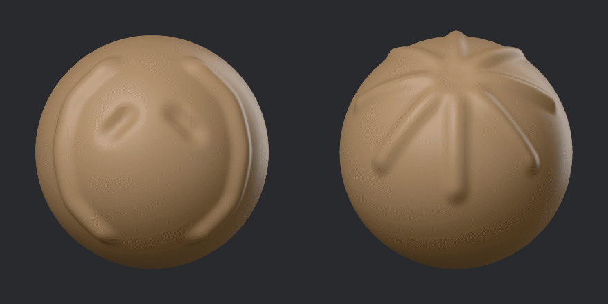

# Symmetry

With symmetry on, every stroke repeats on the other side of the part, or around it. It works for
every brush and for the Gizmo.

## Turning it on

Symmetry's switches sit at the right end of the header:

- **Symmetry on** is the master switch. It is on when GigaSculpt starts, with no axis lit.
- **X**, **Y** and **Z** (Mirror X, Mirror Y and Mirror Z) light each axis. Click X to mirror
  every stroke from left to right.

Turning the master switch off keeps which axes are lit, so turning it on again brings them
back. The quick menu (Shift+Space) has the same switches. Symmetry is one setting for the whole
session, not for each brush.

## Mirror, Parallel and Radial

The ▼ beside the axes (Symmetry kinds) sets what each lit axis does:

| Kind | What it does |
|---|---|
| Mirror | A flipped copy across the middle. A stroke on the left side draws its mirror image on the right. |
| Parallel | The same stroke shifted across, not flipped: a Move dragged to the left moves its copy to the left too, and an alpha reads the same way round on both sides. |
| Radial | Copies around the axis, like slices of a pie. Radial count sets how many, from 2 to 64. |

One axis at most can be Radial; making another axis Radial turns the old one back to Mirror.
Radial count shows while an axis is Radial.

## Where the middle is

Symmetry's planes run through the part's own origin, along the part's own axes, not the
scene's. A part you moved or turned with the Gizmo keeps its symmetry with it.

If a part's two sides no longer match, Mesh > Mirror and weld X, Y or Z copies the part's + side
onto the other side and joins the seam, so the two sides match again. See
[Detail and remeshing](detail.md#mirror-and-weld).

## Seeing where strokes repeat

With Settings > Cursor > Mirrored rings on, quieter rings show where each dab repeats. See
[Settings](settings.md#cursor).
